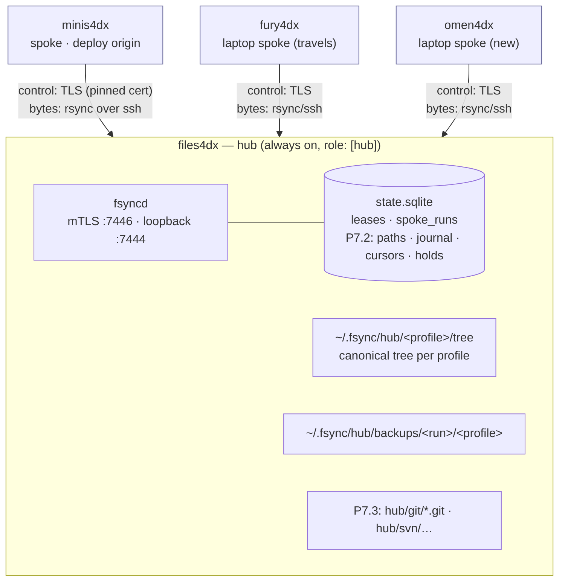
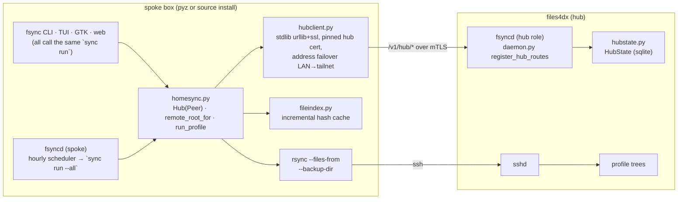
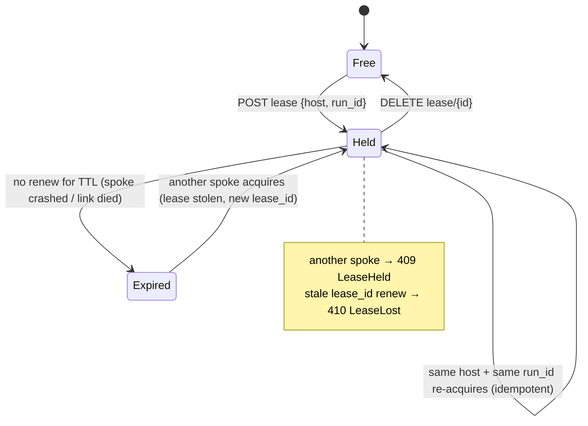
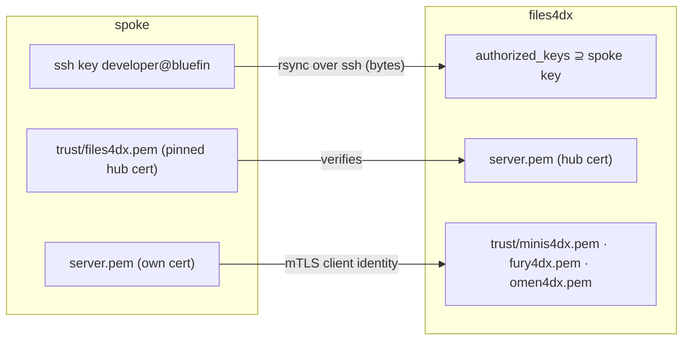
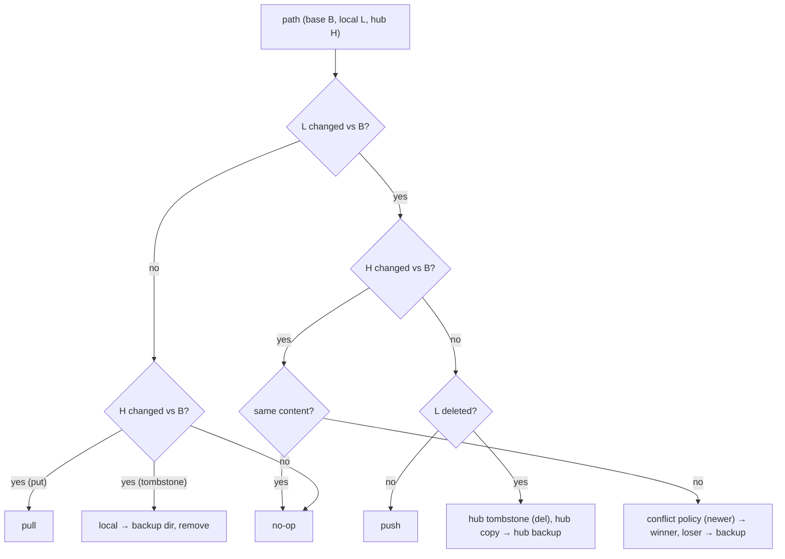

# fsync hub architecture — client/server design (P7)

Companion to [`hub-sync.md`](hub-sync.md) (requirements R30–R42, phases, cutover). This document
is the picture book: what the refactored fsync looks like, how a run flows, and why it is better
than the pairwise design it replaces. State as of fsync 0.8.0 (2026-11-08): P7.1 code shipped,
live config still v1, hub = **files4dx** (user decision).

## 1. Topology: one hub, N spokes



- A spoke talks **only** to the hub. Spokes never hold each other's ssh keys or TLS pins.
- The hub **never initiates** a connection; laptops expose nothing inbound.
- files4dx carries no `$HOME` of its own, so it is hub-only: `fsync sync run` there is a gated no-op.
- Before (v1): two boxes, each the other's "peer", one-way flows chosen per profile to dodge
  resurrections. Adding a third box would have meant three pairs, six directions, and no single
  producer.

## 2. Components and where they run



| Module | Role | Runs on |
|---|---|---|
| `homesync.py` | config v2 loader, `Hub` object, the one place a counterpart path is decided (`remote_root_for`), the spoke run, per-profile lease wrapper | spokes (and hub for `hub init`) |
| `hubstate.py` | sqlite leases + spoke run records; `Lease` renews at TTL/3 | hub daemon; hub box tools |
| `hubclient.py` | stdlib TLS client to the hub API | spokes |
| `hub.py` | picks local-sqlite vs remote-API control plane; `fsync hub init \| status` | all |
| `daemon.py` | existing fsyncd + `/v1/hub/*` routes mounted only when `role: [hub, …]` | all (routes only on hub) |
| `certs.py` | unchanged exact-cert pinning, no CA | all |

## 3. A spoke run, end to end (P7.1 as shipped)

```mermaid
sequenceDiagram
    autonumber
    participant S as spoke (fsync sync run)
    participant H as hub fsyncd (TLS)
    participant T as hub tree (rsync/ssh)

    S->>S: load config v2 → Hub; flock local sync.lock
    S->>T: probe addresses in order (ssh `true`) — LAN name, then tailnet
    Note over S: unreachable on all → clean no-op (R6/R38)
    S->>T: push engine (.pyz) so the hub can index its tree
    loop each file profile
        S->>H: POST /v1/hub/{profile}/lease {host, run_id, ttl}
        alt 409 held by another spoke
            H-->>S: {holder, expires}
            Note over S: profile status = deferred, exit 0, next run retries
        else granted
            H-->>S: {lease_id, expires}
            S->>T: mkdir -p hub tree path
            S->>S: local_index(~/<path>)  (hash cache)
            S->>T: remote index of tree/<path> (hub-side python, JSONL)
            S->>S: compare → plan (newest wins, renames demoted)
            S->>T: rsync push leg  (--backup-dir hub/backups/<run>)
            T-->>S: rsync pull leg  (--backup-dir ~/.fsync/backups/<run>)
            S->>H: POST /v1/hub/{profile}/lease {lease_id}  (renew, background, TTL/3)
            S->>H: POST /v1/hub/{profile}/runs {host, run_id, summary}
            S->>H: DELETE /v1/hub/{profile}/lease/{lease_id}
        end
    end
    S->>S: write ~/.local/state/fsync/runs/<run_id>/report.json
```

What stays exactly as today: the index/compare/plan engine, rsync legs with backup-dir safety,
`merge_jsonl` union merges, the ISSUE-010 resurrection detector (now comparing against the hub
tree), the run report and desktop notifications.

## 4. Lease lifecycle (R36) — replaces the cross-box flock probe



No manual unlock exists by design: the TTL (default 15 min, renewed while rsync runs) is the unlock.

## 5. Security and channels



- **No CA.** Each box has one self-signed cert; the counterpart pins that exact cert (`CA:FALSE`,
  `check_hostname` off), so the same pin is valid on `files4dx.lan` and on a tailnet name.
- **Adding a box** = its ssh key accepted on the hub (already true for `developer@bluefin`) + two
  `fsync daemon trust` commands. Nothing changes on the other spokes.
- **Loopback** API on the hub is token-gated (0600 file) for the hub's own tools; spokes come in
  on the mTLS port with a client cert, no token.

## 6. Three-way reconcile (P7.2, designed, not shipped)

Each spoke keeps the hub state it last converged to (the *base*). Classification per path:



With the hub **journal** (`seq, profile, path, op, hash, origin, ts`) and a **cursor** per spoke,
"what did I miss while away for four days" is one query, replayed once. Tombstones make deletes
and renames first-class, reversible (backup, never `rm`). This is what retires today's one-way
profiles and the `git-bundles` / `svn-snapshots` carrier profiles.

## 7. Phases

```mermaid
gantt
    dateFormat  YYYY-MM-DD
    axisFormat  %b %d
    title fsync P7 hub-sync
    section P7.0 prep
    du + decisions (41 GB, hub = files4dx)      :done, p70, 2026-11-08, 1d
    section P7.1 star, additive
    code 0.8.0 (Hub, leases, routes, CLI)       :done, p71, 2026-11-08, 1d
    cutover: install on files4dx, trust, seed   :active, p71c, 2026-11-09, 3d
    section P7.2 state
    tombstones, journal, cursors, 3-way         :p72, after p71c, 10d
    section P7.3 kinds
    git/svn hub stores, self-update             :p73, after p72, 7d
```

## 8. Benefits, in one table

| Pairwise v1 (today's live config) | Hub (P7) |
|---|---|
| exactly one `peer:` per box; O(N²) keys, pins, address lists | one hub; a spoke trusts the hub only |
| one-way profiles because two live homes cannot express a delete | hub tombstones + journal (P7.2); every profile two-way |
| whole-box `peer_busy` flock probe over ssh | per-profile hub lease with TTL; crashed spoke self-heals |
| a laptop away for days re-plans against a live tree that moved on | journal since `last_seq`: replay exactly what was missed, once |
| stale git bundle / svn snapshot can re-apply over fresh work | hub store knows ancestry (P7.3); stale replay is a no-op |
| "who is behind?" = read two run reports | `fsync hub status`: per profile, per spoke |
| dev boxes are each other's servers | files4dx — always on, 238 GB NVMe free, 65 TB tank behind it |

Trade-offs: the hub is a single dependency (no hub, no sync); the tree is a second copy of the
carry-set; P7.1 is still additive, so the churny profiles stay one-way per host until P7.2.
